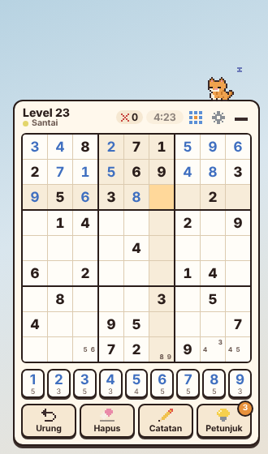
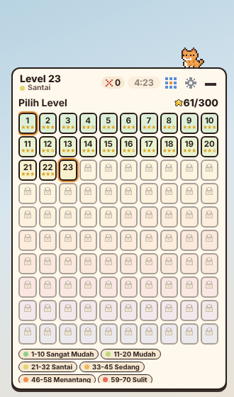
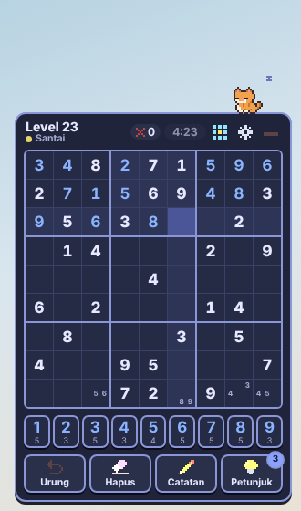

# Sudoku Pojok

Widget sudoku kecil yang tinggal di pojok kanan bawah desktop, untuk mengisi jeda sebentar di sela bekerja. Ada **100 level** yang makin sulit, dari teka-teki dengan banyak angka awal sampai teka-teki yang butuh teknik lanjutan seperti XY-Wing dan XYZ-Wing. Dibuat dengan **Tauri 2 + TypeScript**, tanpa game engine dan tanpa framework. Maskot kucing pixel art dan semua ikonnya digambar oleh kode.

<p>
  
  
  
</p>

## Unduh dan main

Buka halaman **[Releases](https://github.com/iniArsat/sudoku-pojok/releases/latest)**. Installer dibuat otomatis oleh GitHub Actions setiap ada perubahan di branch `main`.

**Windows:** unduh file yang berakhiran `-setup.exe`, lalu klik dua kali untuk memasang.

**Mac (Apple Silicon dan Intel, macOS 10.15 atau lebih baru):**
1. Unduh file yang berakhiran `_universal.dmg`, buka, lalu seret **Sudoku Pojok** ke folder **Applications**.
2. Aplikasi ini belum ditandatangani Apple, jadi macOS menolaknya saat pertama dibuka. Buka **Terminal** dan jalankan sekali:
   ```
   xattr -cr "/Applications/Sudoku Pojok.app"
   ```
   Cara lain: coba buka sekali, lalu buka **System Settings → Privacy & Security** dan klik **Open Anyway**.

Widget muncul di pojok kanan bawah, di atas taskbar/Dock. Ikon Sudoku Pojok di tray (Windows: dekat jam; Mac: menu bar) untuk menampilkan, menyembunyikan, atau keluar.

## Cara main

- Klik sel, lalu klik angka di bawah papan (atau tekan **1-9** di keyboard). Angka di bawah tiap tombol menunjukkan berapa kali angka itu masih perlu diisi.
- Angka yang **benar** langsung terkunci. Angka yang **salah** berwarna merah, dihitung sebagai kesalahan, dan bisa dihapus.
- **Catatan** (tombol pensil atau tombol **N**) untuk menulis kandidat kecil di sel. Catatan di baris, kolom, dan kotak yang sama terhapus otomatis saat angka benar dimasukkan.
- **Urung** (**Z**) membatalkan langkah terakhir. **Hapus** (**Backspace**) menghapus isian salah atau catatan.
- **Petunjuk** (**H**, maksimal 3 per level) mengisi satu sel dan menjelaskan alasannya, misalnya "Di kotak ini, angka 7 hanya bisa diletakkan di sel ini."
- **Bintang:** 3 bintang bila selesai tanpa salah dan tanpa petunjuk, 2 bintang bila paling banyak 2 salah dan 1 petunjuk, selain itu 1 bintang. Waktu terbaik tiap level dicatat.
- Waktu hanya berjalan saat kamu bermain. Kalau 30 detik tidak menyentuh papan (misalnya kembali bekerja), waktu berhenti sendiri.
- Tombol **–** menciutkan widget menjadi pil kecil; klik pil untuk membuka lagi.

## 100 level

Level dibuat sekali oleh `scripts/generate-levels.ts` dan disimpan di `src/core/levels.json`. Setiap teka-teki punya **satu solusi**, dan selalu bisa dipecahkan **dengan logika, tanpa menebak**. Kesulitannya diukur dengan pemecah yang bekerja seperti manusia: teknik termudah dulu, lalu dicatat teknik tersulit yang diperlukan.

| Level | Tingkat | Yang dibutuhkan |
| --- | --- | --- |
| 1-10 | Sangat Mudah | 46 sampai 37 angka awal, cukup mencari tempat satu-satunya di kotak |
| 11-20 | Mudah | 36 sampai 32 angka awal, mencari di baris dan kolom |
| 21-32 | Santai | 31 sampai 26 angka awal |
| 33-45 | Sedang | sel yang hanya bisa diisi satu angka |
| 46-58 | Menantang | kandidat terkunci |
| 59-70 | Sulit | pasangan terbuka, pasangan tersembunyi |
| 71-80 | Sangat Sulit | tripel terbuka, Swordfish |
| 81-90 | Ahli | tripel tersembunyi, XY-Wing |
| 91-100 | Master | XYZ-Wing |

Level terbuka berurutan. Level yang ditinggal di tengah jalan tetap tersimpan dan bisa dilanjutkan.

## Tema dan pengaturan

- 7 tema yang terbuka dengan bintang: **Kertas**, **Malam** (10 bintang), **Matcha** (30), **Sakura** (60), **Laut** (100), **Kayu** (150), **Retro** (210).
- Sorot angka yang sama, hapus catatan otomatis, tampilkan waktu, posisi kiri/kanan bawah, ukuran kecil/sedang/besar, efek suara, dan jalankan saat komputer menyala.
- Statistik: level selesai, bintang, waktu bermain, hari beruntun, kesalahan, dan petunjuk.

## Pengembangan

```
npm install
npm run dev          # mode browser di http://localhost:1420
npm test             # tes mesin sudoku, 100 level, dan aturan permainan
npm run levels       # buat ulang 100 level (hasilnya selalu sama)
npm run tauri dev    # aplikasi desktop (butuh Rust)
```

Struktur:
- `src/core/sudoku.ts`: pemecah cepat (bitmask), pembuat teka-teki, dan penilai kesulitan dengan 16 teknik logika.
- `src/core/game.ts`: aturan permainan (isi, catatan, urung, petunjuk, bintang, level terbuka).
- `src/ui`: widget, ikon piksel, dan suara WebAudio. `src/render/mascot.ts`: maskot kucing.
- `src-tauri`: jendela transparan di pojok, klik tembus, tray, dan file simpanan.
